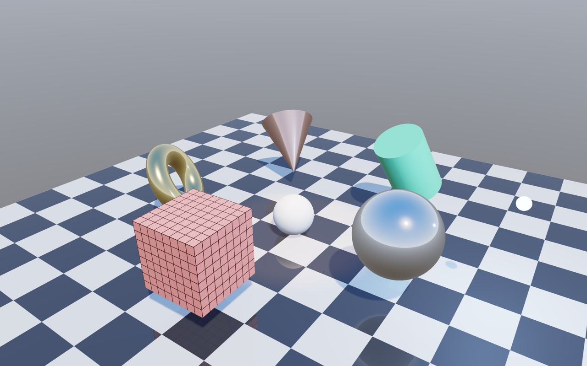

# mini3d

A small real-time 3D engine in Rust. It renders primitive shapes with physically based lighting,
shadows, reflections and HDR. It uses [wgpu](https://wgpu.rs) for graphics (Metal on macOS) and
[winit](https://github.com/rust-windowing/winit) for the window and input.



## Requirements

- macOS on Apple Silicon or Intel with Metal support
- Rust 1.85 or newer (2021 edition); tested with Rust 1.89

wgpu is cross-platform, so the engine should also build on Windows and Linux. Only macOS has been tested.

## Running

```sh
cargo run --release
```

Command-line options can be combined:

```sh
cargo run --release -- photo.jpg              # use an image as the cube's texture
cargo run --release -- studio.hdr             # use an HDR panorama as the sky and lighting
cargo run --release -- --screenshot out.png   # save the first frame and quit
cargo run --release -- --keys "1[[" --screenshot night.png   # press keys first (sun off, dim sky)
```

Free HDR panoramas are available from [Poly Haven](https://polyhaven.com/hdris).
Use the equirectangular `.hdr` downloads.

### Controls

| Input     | Action                                      |
| --------- | ------------------------------------------- |
| Left-drag | Orbit the camera                            |
| Scroll    | Zoom in / out                               |
| 1 / 2 / 3 | Toggle the sun / point light / spotlight    |
| H         | Toggle shadows                              |
| R         | Toggle mirror reflections                   |
| T         | Cycle tonemap curve: ACES → Reinhard → clamp |
| - / =     | Decrease / increase exposure                |
| [ / ]     | Decrease / increase sky (environment) light |
| P         | Save a screenshot (`mini3d-<time>.png`)     |
| Space     | Pause / resume animation                    |
| Esc       | Quit                                        |

The window title shows which lights are on and the current settings.

## Features

#### Lighting

- Physically based shading (Cook-Torrance GGX) with metallic-roughness materials
- Directional, point and spot lights, up to 16 at once
- Image-based lighting: the sky lights the scene and appears in reflections, blurrier on rougher surfaces
- Emissive materials

#### Shadows

- Shadow map (2048²) for the sun, with soft edges (5×5 percentage-closer filtering)
- Slope-scaled depth bias and normal offset to avoid "shadow acne"

#### Reflections

- Environment reflections on every surface, strongest on metals and smooth materials
- One planar mirror (e.g. a polished floor) that reflects the actual scene, rendered from a mirrored camera

#### HDR

- Renders into a 16-bit float target, so brightness can go far above white
- Tone mapping with adjustable exposure: ACES filmic, Reinhard, or a plain clamp for comparison
- Loads Radiance `.hdr` panoramas, or generates a procedural sky with a bright HDR sun

#### Also

- Procedural meshes: cube, plane, UV sphere, cylinder, cone, torus, all with normals and texture coordinates
- Textures from PNG/JPEG or generated in code, with automatic mipmaps and anisotropic filtering
- 4× MSAA anti-aliasing, orbit camera, window resizing, offscreen screenshots

### How a frame is rendered

1. **Shadow pass**: depth from the sun's point of view into the shadow map.
2. **Reflection pass**: the scene seen from a camera mirrored below the mirror plane, into a texture.
3. **Main pass**: every object shaded in HDR, then the sky drawn behind them, with 4× MSAA.
4. **Tonemap pass**: exposure and tone curve, from HDR to the screen.

Passes 1 and 2 are skipped when shadows or reflections are off, or when nothing needs them.

## Project layout

```text
tests/
└── render.rs              End-to-end GPU rendering tests
src/
├── lib.rs                 Library entry point (the engine)
├── main.rs                Demo app: scene, input handling, command line
└── engine/
    ├── mod.rs             Public re-exports
    ├── renderer.rs        wgpu setup, pipelines, render passes, screenshots, Transform
    ├── scene.rs           Meshes, textures, objects and lights
    ├── material.rs        PBR material
    ├── light.rs           Directional, point and spot lights
    ├── environment.rs     HDR images, procedural sky, environment upload
    ├── texture.rs         Image loading/generation, mipmaps, texture upload
    ├── mesh.rs            Vertex format and primitive generators
    ├── camera.rs          Orbit camera
    └── shaders/
        ├── pbr.wgsl       Lighting, shadows, reflections
        ├── shadow.wgsl    Depth-only shadow map pass
        ├── sky.wgsl       Environment background
        └── tonemap.wgsl   HDR → screen
```

## Usage

### Objects and materials

Upload a mesh once, then spawn as many objects as you like with it:

```rust
use engine::{Material, Mesh, Scene, Transform};
use glam::Vec3;

let sphere = scene.add_mesh(&renderer, &Mesh::sphere(0.5, 32, 16));

let gold = Material::color([1.0, 0.78, 0.34]).metallic(1.0).roughness(0.2);
let id = scene.spawn(&renderer, sphere, Transform::at(Vec3::new(0.0, 2.0, 0.0)), gold);

// Change anything later, e.g. every frame:
scene.objects[id].transform.position.y += 0.01;
scene.objects[id].material.roughness = 0.6;
```

| Material builder              | Meaning                                                       |
| ----------------------------- | ------------------------------------------------------------- |
| `Material::color([r, g, b])`  | Start from a linear base color (roughness 0.5, not metal)     |
| `.metallic(0..1)`             | 0 = plastic, stone, wood; 1 = metal                           |
| `.roughness(0..1)`            | 0 = mirror-smooth; 1 = fully matte                            |
| `.texture(id)`                | Color texture, multiplied by the base color                   |
| `.emissive([r, g, b], power)` | Light the surface gives off; power above 1 glows in HDR       |
| `.mirror(0..1)`               | Planar scene reflection; one object per scene, horizontal only |
| `.uv_scale(u, v)`             | Repeat the texture                                            |

Available meshes:

| Function                                     | Shape                 |
| -------------------------------------------- | --------------------- |
| `Mesh::cube(size)`                           | Axis-aligned cube     |
| `Mesh::plane(size, subdivisions)`            | Flat square facing +Y |
| `Mesh::sphere(radius, sectors, stacks)`      | UV sphere             |
| `Mesh::cylinder(radius, height, segments)`   | Capped cylinder       |
| `Mesh::cone(radius, height, segments)`       | Cone with a base cap  |
| `Mesh::torus(major, minor, segments, sides)` | Torus (ring)          |

### Lights

```rust
use engine::Light;

// Sun: direction the light travels. Only one directional light casts shadows.
scene.add_light(Light::directional(Vec3::new(-0.5, -1.0, -0.4), [1.0, 0.95, 0.85], 3.0).with_shadows());

// Point light: position, color, intensity, range (no light beyond it).
let lamp = scene.add_light(Light::point(Vec3::new(2.0, 1.5, 0.0), [0.4, 0.6, 1.0], 30.0, 9.0));

// Spotlight: position, direction, color, intensity, range, inner and outer half-angles in degrees.
scene.add_light(Light::spot(Vec3::new(0.0, 5.0, 0.0), -Vec3::Y, [1.0, 0.6, 0.3], 80.0, 12.0, 14.0, 22.0));

scene.lights[lamp].set_position(Vec3::new(0.0, 2.0, 2.0));
scene.lights[lamp].enabled = false;
```

Point and spot lights fade with distance squared, so they need much higher intensities than the sun.
Shadows cover a sphere around `scene.shadow_center` with `scene.shadow_radius` (default 8).
A smaller radius gives sharper shadows.

### Environment and HDR settings

```rust
use engine::{HdrImage, Tonemap};

renderer.set_environment(&HdrImage::from_file("studio.hdr")?);
// or a generated sky whose sun matches your directional light:
renderer.set_environment(&HdrImage::sky(1024, 512, -sun_direction));

renderer.exposure = 1.5;                // brighter
renderer.tonemap = Tonemap::Reinhard;   // Aces (default), Reinhard, Clamp
renderer.environment_intensity = 0.5;   // dimmer sky and sky lighting
renderer.shadows = false;
renderer.reflections = false;

renderer.screenshot(&scene, &camera).save("frame.png")?;
```

### Textures

```rust
use engine::Image;

let brick = scene.add_texture(&renderer, &Image::from_file("assets/brick.png")?);
let material = Material::color([1.0; 3]).texture(brick).uv_scale(4.0, 4.0);
```

| Function                                       | Image                                    |
| ---------------------------------------------- | ---------------------------------------- |
| `Image::from_file(path)`                       | PNG or JPEG from disk                    |
| `Image::from_bytes(bytes)`                     | PNG or JPEG in memory (`include_bytes!`) |
| `Image::new(width, height, rgba_pixels)`       | Raw RGBA8 pixel data                     |
| `Image::from_fn(width, height, \|x, y\| rgba)` | Generated pixel by pixel                 |
| `Image::solid(rgba)`                           | 1×1 single color                         |
| `Image::checker(size, cells, a, b)`            | Checkerboard                             |
| `Image::grid(size, cells, line, background)`   | Grid lines, good for checking UVs        |

Pixel data is 8-bit sRGB RGBA, top row first. Each primitive maps images upright and unmirrored when
seen from outside.

## Testing

```sh
cargo test --release
```

There are two kinds of tests:

- **Unit tests** (in each `src/engine/*.rs` file) check the math and data without a GPU: mesh
  winding and UVs, mipmaps, PNG and HDR loading, the sky generator, light constructors, and the
  shadow and mirror matrices.
- **End-to-end tests** ([tests/render.rs](tests/render.rs)) render small scenes on the GPU without a
  window, then check pixels at the screen positions of known 3D points. They cover lights (on/off,
  direction, falloff, range, spot cone and aim, color), shadows (position, toggling, no acne),
  reflections (mirror floor, underside of objects, clipping, metal tinting), HDR (tone curves,
  exposure, very bright values), textures, every primitive from six angles, and GPU validation errors.

The end-to-end tests check behavior, such as "the floor behind the cube is darker than the floor in
the sun", rather than comparing against reference images. This keeps them stable across GPUs. On a
machine without a GPU, they print a message and pass.

To run one test, or see its log output:

```sh
cargo test --release --test render shadow          # tests with "shadow" in the name
RUST_LOG=debug cargo test --release --test render -- --nocapture
```

The tests were checked against four deliberately planted bugs, one at a time. Each made at least
one test fail: a flipped light direction (9 failures), a missing mirror clip plane, ignored shadows, and
wrong face culling in the reflection pass.

For your own tests, use `Renderer::headless(width, height)` and `renderer.screenshot(&scene, &camera)`.

## Limitations

- Only one directional light casts shadows. Point and spot lights don't, and there are no cascades,
  so shadows are sharp only within `shadow_radius`.
- Only one planar mirror, and it must be horizontal. Other objects reflect only the sky, not each other.
- Rough reflections come from the environment's blurred mip levels, not a proper prefiltered convolution.
  This is fast and looks reasonable, but isn't exact.
- No bloom, transparency or normal maps yet.
- Output is tone-mapped to standard dynamic range; the engine doesn't use macOS EDR (extended
  brightness) displays.
- `Transform` supports uniform scale only, because normals are transformed with the model matrix.
- One draw call per object per pass, which is fine for small scenes but not for thousands of objects.

## License

No license has been chosen yet.
